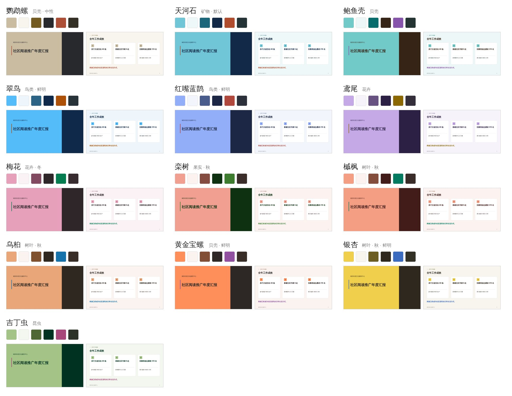

# GarmanPPT（garman-ppt）

一个 AI 技能包：把定稿的讲稿（.docx / .md / .txt）一键变成可编辑的 .pptx 课件，页面放原文摘句，完整原文进讲稿备注。

**完整介绍：[zhaodun.work/ppt](https://www.zhaodun.work/ppt/)**　·　当前版本 0.3.2 试用版

## 它做什么

读文档、安排分页、生成 .pptx，成品能在 PowerPoint 里继续编辑，不是图片拼贴。

- **页面只放原文摘句**：完整原文放进每一页的讲稿备注，讲解时对着备注念就行。
- **卡片式逐个推进**：要点逐条出现，讲一条按一下，不提前剧透。
- **逐字校验**：摘句必须与原文完全一致，对不上会自动修正，不会编造内容。
- **13 套 Garman 自然色**：每套取自一种自然物，按讲稿主题挑选。

## 效果

**普通效果**：浅色底配白色卡片，清爽正式，适合白天投影和打印讲义。

 

**毛玻璃效果**（实验）：深色模糊背景配半透明玻璃卡片，适合大屏和暗光环境。

 

两种效果在生成前切换，同一份讲稿可以出两种版本。

**卡片逐个推进**：讲一条、按一下、下一条出现，前面的自动变淡但不消失。走完整页再点一次，所有卡片同时恢复高亮。

录屏来自《智能体的初步应用》第 16 页。

动画用的是 PowerPoint 原生动画（「进入 → 出现」和「强调 → 透明」），打开就能放映，也能随时增删卡片、调整节奏。

## 13 套 Garman 自然色

每套配色取自一种自然物，明暗结构、版式、动画完全相同，只换颜色。默认的天河石来自赵盾矿物色彩系统 v2.3。

| 配色 | 来源 | 色调与适用 |
|---|---|---|
| 天河石（默认） | 矿物 | 青蓝配橙红；工作汇报、公文 |
| 鹦鹉螺 | 贝壳 | 象牙米白配赭红；人文、历史 |
| 鲍鱼壳 | 贝壳 | 珠光蓝绿配紫；科技、海洋、环保 |
| 翠鸟 | 鸟类 | 天蓝配栗橙；教学、活动、少儿 |
| 红嘴蓝鹊 | 鸟类 | 宝蓝配红；宣传、活动 |
| 鸢尾 | 花卉 | 淡紫配姜黄；文艺、读书 |
| 梅花 | 花卉 | 梅粉配苔青；节庆、传统文化 |
| 栾树 | 果实 | 珊瑚粉配墨绿；社区、民生 |
| 槭枫 | 树叶 | 枫红橙配松绿；年终总结 |
| 乌桕 | 树叶 | 杏橙配秋空蓝；乡村、文旅 |
| 黄金宝螺 | 贝壳 | 赤橙配紫；庆典、活动 |
| 银杏 | 树叶 | 金黄配蓝；校园、秋季 |
| 吉丁虫 | 昆虫 | 豆绿配紫红；农业、健康 |

每套配色的来历和大图见 [Garman 自然色图鉴](https://www.zhaodun.work/color/#garman)。

## 用法

1. 从 [Releases](https://github.com/99243537-sketch/garman-ppt/releases/latest) 下载最新版 `garman-ppt-x.y.z.zip`。
2. 装进你用的 AI 工具（WorkBuddy、ChatGPT 等支持技能的工具）。不支持导入的，解压后把 `garman-ppt` 文件夹直接发给它。
3. 把定稿文档一起发过去，说：「做成 PPT」。它会先列出 13 套配色并按讲稿推荐 3 套，同时问你要普通还是毛玻璃效果。拿不准就说「推荐的 3 套都做」，一次出 3 个版本对比。

做完想换颜色，说一声配色名就行，分页和文字不变。技能在本地跑，不上传文档。

生成后请用 PowerPoint 或 WPS 放映检查一遍。手机预览可能替换字体、看不到动画。

## 适合什么场合

讲稿已经定好、只差一份能讲的课件，比如培训课件、读书分享、课题汇报。这个技能省掉的是排版和逐条整理，不是替你写内容。

## 开发者信息

| 路径 | 内容 |
|---|---|
| `skill/garman-ppt/` | 正式技能（单文件脚本，无需 npm install） |
| `tools/doc2ppt/` | 正式技能源码（Node 与浏览器共用） |
| `tools/palette/` | 推色脚本，生成 `tools/doc2ppt/src/themes.js` |
| `skill-probe/` | 兼容性测试技能，见 [docs/测试技能.md](docs/测试技能.md) |
| `docs/` | 设计说明、色彩规范、交接记录、攻略 |
| `web/`、`server/` | 已取消的网页版，只作存档 |

**发布流程**：`skill/` 或 `skill-probe/` 有改动推到 main 后，`.github/workflows/release.yml` 自动打包并上传到对应 Release。

## 署名

默认配色「天河石」基于赵盾矿物色彩系统 v2.3，其余 12 套按同一结构推出（见 [docs/Garman色彩规范-v3.md](docs/Garman色彩规范-v3.md)）。转载或商用请注明出处：赵盾 AI 学习工作室 · zhaodun.work
