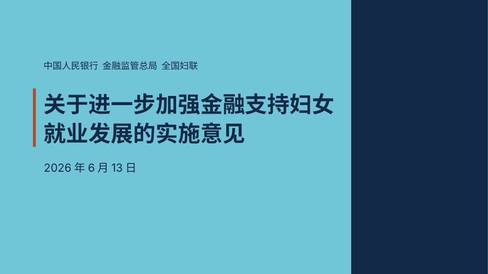
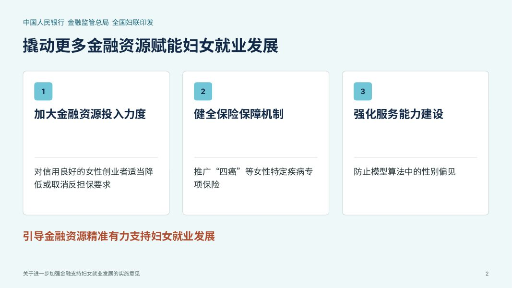
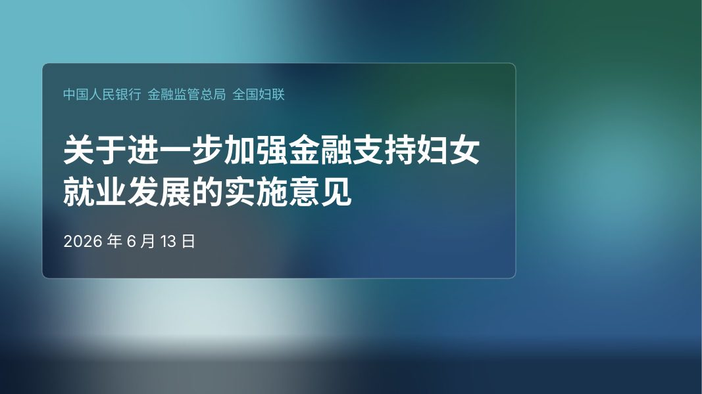
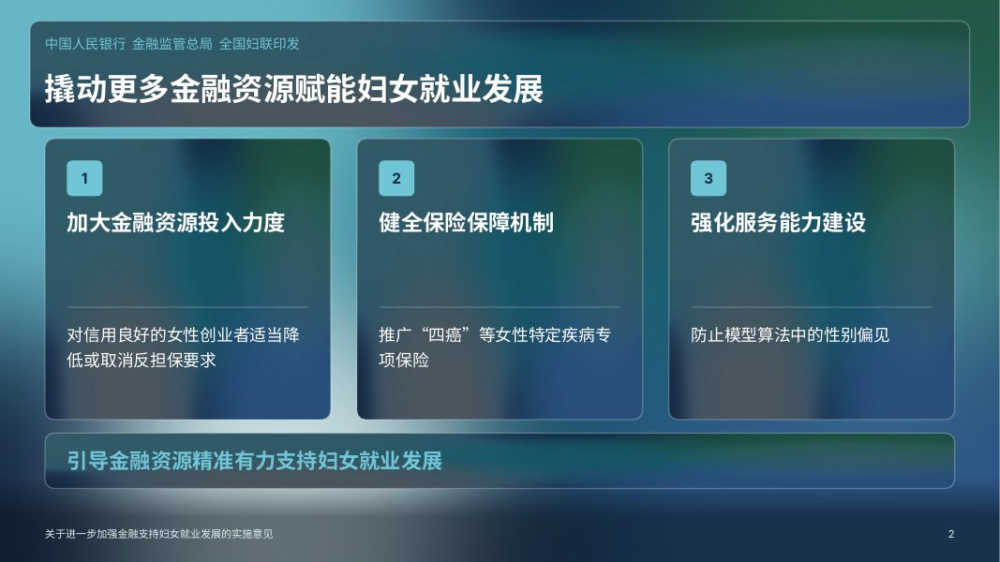
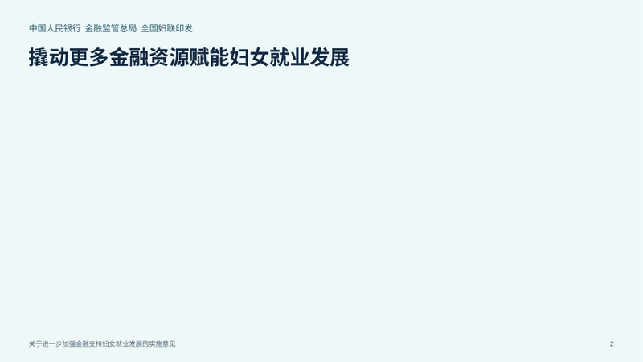

# 天然矿物色 PPT 讲稿制作（mineral-ppt）

把已经定稿的讲稿（.docx / .md / .txt）转成可编辑的 .pptx 课件：页面只放原文摘句，完整原文放进讲稿备注，卡片带讲课动画。

**完整介绍和在线试用：[zhaodun.work/ppt](https://www.zhaodun.work/ppt/)**　·　当前版本 0.2.1 试用版

## 效果

**普通效果**：浅色底、白色卡片，清爽正式。

 

**毛玻璃效果**：深色模糊矿物背景、半透明玻璃卡片。

 

**讲课动画**：放映时卡片一张张出现，讲到下一张时上一张变淡，最后一次点击全部恢复。

## 五种矿物色

配色来自赵盾矿物色彩系统 v2.3，字体统一用微软雅黑。

| 矿物 | 色值 | 用途 |
|---|---|---|
| 天河石 | `#70C6D6` | 封面底色、编号块 |
| 青金石 | `#122947` | 标题、章节页底色 |
| 孔雀石 | `#245F4D` | 第二类别 |
| 磷氯矿石 | `#59652E` | 第三类别 |
| 钒铅矿 | `#B04D2F` | 每页一处关键结论 |

## 用法

1. 从 [Releases](https://github.com/99243537-sketch/mineral-ppt/releases/latest) 下载最新版 `mineral-ppt-x.y.z.zip`。
2. 导入你用的 AI 工具（WorkBuddy、OpenClaw、ChatGPT 等能运行代码的智能体）。不支持导入技能的，把压缩包直接发给它。
3. 把定稿文档一起发过去，说：「做成 PPT」。想要毛玻璃效果就加一句「毛玻璃效果」。

生成后请用 PowerPoint 或 WPS 放映检查一遍。手机预览可能替换字体、看不到动画。

不想装技能，也可以直接在[网页版](https://www.zhaodun.work/ppt/)上传文档生成（5000 字以内）。

## 开发者信息

| 路径 | 内容 |
|---|---|
| `skill/mineral-ppt/` | 正式技能（单文件脚本，无需 npm install） |
| `tools/doc2ppt/` | 正式技能源码（Node 与浏览器共用） |
| `web/` | 网页版前端（部署到 zhaodun.work/ppt/） |
| `server/` | 网页版后端：分页方案服务 ppt-planner |
| `skill-probe/` | 兼容性测试技能，见 [docs/测试技能.md](docs/测试技能.md) |
| `docs/` | 设计说明、交接记录、攻略 |

**发布流程**：`skill/` 或 `skill-probe/` 有改动推到 main 后，`.github/workflows/release.yml` 自动打包并上传到对应 Release。

## 署名

默认配色基于赵盾矿物色彩系统。转载或商用请注明出处：赵盾 AI 学习工作室 · zhaodun.work
